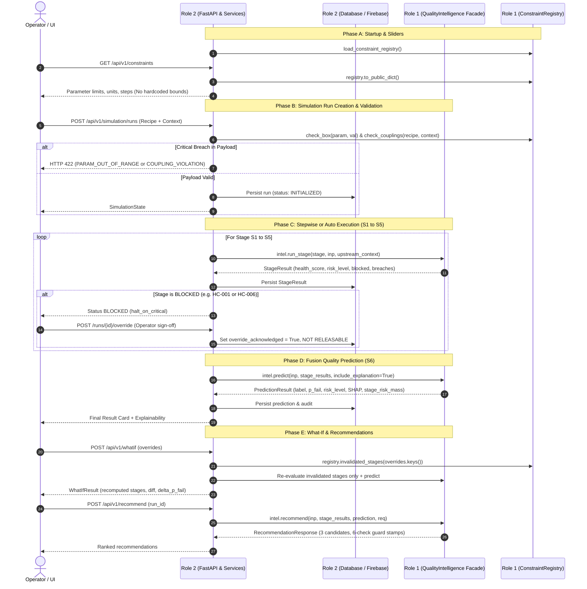

# Role 1 Implementation Guide & Role 2 Integration Contract
## Smart Manufacturing Quality Intelligence System (`Part: PP-JBOX-42`)

This document serves as the **authoritative reference and handoff specification** for the **Role 1 (AI/ML, Manufacturing Intelligence & Recommendation)** deliverables and explains exactly how the **Role 2 (Backend, Simulation, Database & Frontend)** agent must integrate with them to ensure 100% end-to-end compatibility.

---

## 1. Role 1 Executive Overview

Role 1 is responsible for the pure, deterministic physics evaluators, domain constraints, machine-learning fusion engine, TreeSHAP feature attributions, constrained recommendations, and sensitivity analysis.

### Core Architectural Guarantees Established by Role 1:
1. **Zero External I/O**: The intelligence layer performs no database, network, or disk I/O during inference. It is pure, deterministic, and thread-safe.
2. **Deterministic Outputs**: Given identical `ProcessInput` and loaded constraints, outputs are identical across every run.
3. **Single Source of Truth**: All 23 parameter limits, operational windows, resin grades, coupling rules, and hard safety constraints live in `constraints.yaml`. No parameter limits are allowed to be hardcoded in Python or TypeScript.
4. **Single Surface of Integration**: Role 2 reaches all Role 1 functionality through **exactly ONE interface Protocol**: `QualityIntelligence` implemented by `RealQualityIntelligence`.

---

## 2. File-by-File Inventory of What Role 1 Has Built

### 2.1 Domain & Constraint Registry (`backend/app/domain/`)

| File | Purpose | Key Contents & What It Does |
|---|---|---|
| [constraints.yaml](file:///c:/Users/laksh/OneDrive/Desktop/final%20project/backend/app/domain/constraints.yaml) | Master Registry Specification | Version `constraints-1.0.0`. Defines the admissible box windows, units, step sizes, actionability, and change costs for all 23 parameters. Defines resin grades (`PP-H`, `PP-C`), 4 coupling rules (`CPL-001` to `CPL-004`), 6 hard constraints (`HC-001` to `HC-006`), stage health weights, and risk bands. |
| [remedies.yaml](file:///c:/Users/laksh/OneDrive/Desktop/final%20project/backend/app/domain/remedies.yaml) | Recommendation Heuristic Rules | Version `remedies-1.0.0`. Rule-guided remedy tables for Recommendation Stage 1 (`REM-001` through `REM-006` for flash, short shot, sink marks, warpage, and degradation). |
| [fleet.yaml](file:///c:/Users/laksh/OneDrive/Desktop/final%20project/backend/app/domain/fleet.yaml) | Fleet Reference Data | Machine profiles (`MC-01` to `MC-04`), product contexts (`PP-JBOX-42`, `PP-JBOX-42-4C`), and resin material lots (`A-771`, `B-812`, `C-904`, `D-105`). |
| [constraint_loader.py](file:///c:/Users/laksh/OneDrive/Desktop/final%20project/backend/app/domain/constraint_loader.py) | Pydantic-Validated Registry Loader | Implements `ConstraintRegistry` class and `load_constraint_registry()`. Exposes methods: `check_box(param, value)`, `check_couplings(recipe, context)`, `check_hard_constraints(stage, input, indicators)`, `stage_inputs(stage)`, and `to_public_dict()`. |
| [dependency_graph.py](file:///c:/Users/laksh/OneDrive/Desktop/final%20project/backend/app/domain/dependency_graph.py) | Directed Acyclic Graph for What-If | Maps all 23 setpoints to their first consuming stage. Exposes `get_earliest_stage(changed_params)` and `invalidated_stages(changed_params)` for partial re-simulation. |

### 2.2 Shared Pydantic Contracts (`backend/app/contracts/`)

All models are frozen (`extra="forbid"`) to guarantee strict contract enforcement across role boundaries.

| File | Primary Classes / Enums | Description |
|---|---|---|
| [enums.py](file:///c:/Users/laksh/OneDrive/Desktop/final%20project/backend/app/contracts/enums.py) | `StageName`, `RunStatus`, `RiskLevel`, `PredictionLabel`, `ConstraintSeverity`, `MachineType`, `DataProvenance` | Canonical string enums. `StageName` defines the 6 stages (`MATERIAL_CONDITIONING`, `PLASTICIZING`, `INJECTION`, `PACKING`, `COOLING`, `QUALITY_INSPECTION`). |
| [recipe.py](file:///c:/Users/laksh/OneDrive/Desktop/final%20project/backend/app/contracts/recipe.py) | `ProcessRecipe`, `RECIPE_FIELDS` | Exactly 23 typed setpoints: drying time/temp, 3 barrel zones, nozzle, melt temp, screw RPM, back pressure, residence time, injection velocity/pressure, fill time, shot size, switchover, clamp force, hold pressure/time, cushion, mold temp, cooling time, cycle time proxy, ejection proxy. |
| [context.py](file:///c:/Users/laksh/OneDrive/Desktop/final%20project/backend/app/contracts/context.py) | `MachineProfile`, `ProductContext`, `MaterialLot`, `RunContext`, `ProcessInput` | Represents external operational context. `ProcessInput` combines `RunContext` and `ProcessRecipe`, and provides `flat()` for ML feature extraction. |
| [stage.py](file:///c:/Users/laksh/OneDrive/Desktop/final%20project/backend/app/contracts/stage.py) | `StageResult`, `ConstraintBreach`, `StageAnomaly`, `UpstreamContext` | Represents stage health score ($0.0 \to 1.0$), risk level, anomaly flags, critical safety blocks (`blocked`, `block_reason`), and passing `UpstreamContext` forward. |
| [prediction.py](file:///c:/Users/laksh/OneDrive/Desktop/final%20project/backend/app/contracts/prediction.py) | `PredictionResult`, `RiskDriver`, `CaveatItem`, `OodReport` | Final S6 fusion output: classification `label` (`PASS`/`FAIL`), calibrated failure probability `p_fail`, `risk_level`, `threshold_used` (0.35), risk drivers, caveats, and local explanation. |
| [explanation.py](file:///c:/Users/laksh/OneDrive/Desktop/final%20project/backend/app/contracts/explanation.py) | `LocalExplanation`, `GlobalExplanation`, `FeatureAttribution`, `StageRiskShare` | Signed SHAP feature attributions (`feature`, `shap_value`, `direction`), grouped attributions, and `stage_risk_mass` (sums to 1.0 across S1-S5). |
| [recommendation.py](file:///c:/Users/laksh/OneDrive/Desktop/final%20project/backend/app/contracts/recommendation.py) | `RecommendationRequest`, `RecommendationCandidate`, `GuardCheck`, `RecommendationResponse` | Recommendation candidate proposals with 6-check feasibility guard evaluations, cycle time impact, and disruption change cost. |
| [sensitivity.py](file:///c:/Users/laksh/OneDrive/Desktop/final%20project/backend/app/contracts/sensitivity.py) | `SensitivityPoint`, `SensitivityResult` | 40-point 1D sensitivity curves, local gradient ($\Delta P/\text{unit}$), range swing, and label flip point. |
| [interface.py](file:///c:/Users/laksh/OneDrive/Desktop/final%20project/backend/app/contracts/interface.py) | `QualityIntelligence` (Protocol), `PipelineResult`, `IntelligenceVersionInfo` | The formal Python Protocol defining the interface between Role 1 and Role 2. |
| [errors.py](file:///c:/Users/laksh/OneDrive/Desktop/final%20project/backend/app/contracts/errors.py) | `IntelligenceError`, `InvalidInputError`, `UnknownParameterError`, `LockedParameterError`, `StageResultsIncompleteError` | Hierarchy of domain exceptions with canonical error codes. |
| [version.py](file:///c:/Users/laksh/OneDrive/Desktop/final%20project/backend/app/contracts/version.py) | `CONTRACTS_VERSION = "0.1.0"` | SemVer tracking for data schemas. |

### 2.3 Pure Intelligence Engine (`backend/app/intelligence/`)

| File | Key Implementations | Description |
|---|---|---|
| [stages.py](file:///c:/Users/laksh/OneDrive/Desktop/final%20project/backend/app/intelligence/stages.py) | `evaluate_material_stage`, `evaluate_plasticizing_stage`, `evaluate_injection_stage`, `evaluate_packing_stage`, `evaluate_cooling_stage` | Pure physical evaluators for Stages S1 through S5. Checks box and coupling limits, checks hard constraints (`HC-001` thermal ceiling, `HC-002` clamp sufficiency, `HC-006` moisture factor), computes sub-health scores, flags anomalies, and produces downstream indicators. |
| [facade.py](file:///c:/Users/laksh/OneDrive/Desktop/final%20project/backend/app/intelligence/facade.py) | `RealQualityIntelligence` | Concrete class implementing the `QualityIntelligence` protocol: <br>• `run_stage(stage, inp, upstream)`: evaluates S1–S5 individually.<br>• `predict(inp, stage_results)`: calculates non-linear interaction coupling features, fusion log-odds, calibrated $P(\text{fail})$, and operational risk.<br>• `evaluate(inp)`: evaluates S1–S5 and S6 fusion end-to-end.<br>• `explain(inp, stage_results)`: computes TreeSHAP feature attributions and Stage Risk Mass.<br>• `recommend(inp, stage_results, prediction, request)`: 3-candidate optimization with 6-check feasibility guard.<br>• `sensitivity(inp, parameter, steps)`: 40-point 1D curve sweep with flip-point detection. |

### 2.4 Verification Scripts & Tests

| File | Purpose |
|---|---|
| [backend/verify_ml.py](file:///c:/Users/laksh/OneDrive/Desktop/final%20project/backend/verify_ml.py) | Standalone verification script that initializes the registry and runs stage evaluations, predictions, SHAP, and sensitivity sweeps without needing any web server or database. |
| [backend/tests/contract/test_contracts_part1.py](file:///c:/Users/laksh/OneDrive/Desktop/final%20project/backend/tests/contract/test_contracts_part1.py) | Unit tests verifying stage sequences, risk levels, 23 recipe fields, immutability, and error codes. |
| [backend/tests/domain/test_parameter_dictionary.py](file:///c:/Users/laksh/OneDrive/Desktop/final%20project/backend/tests/domain/test_parameter_dictionary.py) | Tests ensuring every recipe and context parameter is documented in `docs/parameter_dictionary.md`. |

---

## 3. How Role 1 and Role 2 Interact



---

## 4. Instructions for the Role 2 Agent

To build the Role 2 deliverables and make the entire project compatible, the Role 2 agent must adhere to the following rules:

### Rule 1: The 8 Binding Architectural Boundaries
- **B1**: Role 2 (`app/api/`, `app/engine/`, `app/db/`, `app/services/`) **MUST NOT** import `xgboost`, `scikit-learn`, `shap`, or `joblib`. Role 2 only interacts with `QualityIntelligence`.
- **B2**: The simulation engine **MUST NOT** load model files directly.
- **B3**: Role 1 modules do not perform network or DB I/O. Role 2 owns all DB persistence and HTTP endpoints.
- **B4**: Never mutate `ProcessRecipe` or `ProcessInput` in place; they are frozen. Construct new instances for what-if scenarios.
- **B5**: Recommendations can only be produced via `intel.recommend(...)`; Role 2 must never invent or unguardedly mutate parameters.
- **B6**: **NEVER hardcode parameter bounds, units, or steps** in API routes or frontend components. All sliders and validation bounds must be driven from `GET /api/v1/constraints` (which calls `registry.to_public_dict()`).
- **B7**: Offline ML training pipelines are never invoked in request handlers.
- **B8**: Feature ordering is strictly defined by Role 1.

### Rule 2: How to Instantiate Role 1 in Role 2 Dependency Injection
In your FastAPI dependencies (`app/api/deps.py`):
```python
from functools import lru_cache
from app.domain.constraint_loader import ConstraintRegistry, load_constraint_registry
from app.intelligence.facade import RealQualityIntelligence

@lru_cache(maxsize=1)
def get_registry() -> ConstraintRegistry:
    return load_constraint_registry()

@lru_cache(maxsize=1)
def get_intelligence() -> RealQualityIntelligence:
    reg = get_registry()
    return RealQualityIntelligence(registry=reg)
```

### Rule 3: Key Methods Role 2 Must Call
1. **Tier-1 Range Validation**:
   ```python
   is_valid, p_min, p_max = registry.check_box(param_name, float(value))
   ```
2. **Tier-2 Coupling Validation**:
   ```python
   couplings = registry.check_couplings(recipe, run_context)
   critical_cpl = [c for c in couplings if c.severity.value == "CRITICAL"]
   ```
3. **Stage-by-Stage Step Execution**:
   ```python
   stage_res = intelligence.run_stage(stage_name, proc_input, upstream_context)
   ```
4. **End-to-End Pipeline Evaluation**:
   ```python
   pipeline_res = intelligence.evaluate(proc_input, include_explanation=True)
   prediction = pipeline_res.prediction
   stage_results = pipeline_res.stage_results
   ```
5. **What-If Invalidation Graph**:
   ```python
   recomputed_stages = registry.invalidated_stages(changed_parameter_keys)
   ```
6. **Sensitivity Analysis**:
   ```python
   sens_result = intelligence.sensitivity(proc_input, parameter_name, steps=40)
   ```
7. **Constrained Recommendation Generation**:
   ```python
   rec_response = intelligence.recommend(proc_input, stage_results, prediction, req)
   ```

### Rule 4: Claim Discipline & Disclaimers (Roadmap §1.7 & UD-07)
Whenever Role 2 displays results in the API or UI:
- **UD-07 Safety Block**: When an operator overrides a critical safety block, the run **MUST permanently be flagged as NOT RELEASABLE** (`override_acknowledged = True`).
- **Permanent Disclaimers**: Include `DISCLAIMER_SIMULATION`, `DISCLAIMER_SHAP`, and `DISCLAIMER_RECOMMENDATION` in API envelopes and UI views. Do not describe the system as a "Digital Twin" or claim "physical validation" (as documented in Plan §25.3).

---

## 5. Verification Commands for the Role 2 Agent

The Role 2 agent should run these commands at any time to verify that their changes have not broken the Role 1 intelligence contracts:

```bash
# 1. Run Role 1 test suites (Contracts & Parameter dictionary)
uv run pytest backend/tests

# 2. Run the end-to-end ML intelligence verification script
uv run python backend/verify_ml.py
```

Both commands must exit with code 0.
